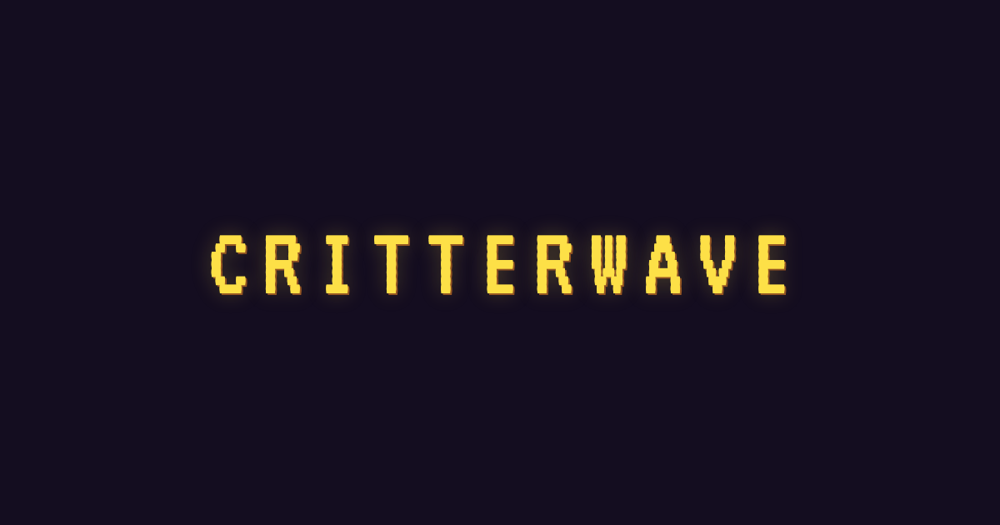

# Critterwave



Choose your critter. Dance for foes. Survive **100 waves**.

A tiny browser RPG: pick a critter hero, fight alliterative foes, heal, dance, and beat the campaign.

**Play online:** [https://bunhouse.itch.io/critterwave](https://bunhouse.itch.io/critterwave)

## Features

- Turn-based combat in the browser · no install
- Win **100 waves** against **101** hand-picked alliterative foes (critters and fantasy creatures)
- **Levels 1–10** · classic RPG pacing: stay Lv 1 for waves 1–10, level up at **11, 21, 31…**. HP, ATK, and max heal grow with you
- Foe **LV** varies around yours · easier critters fight below your level, tougher ones above (same rules from wave 1)
- Pick any roster emoji as your hero, name them, and choose a **card color** · the setup grid only shows **full rows** (the column count follows your window width)
- **Light and dark themes** · The footer toggle remembers your choice. The browser and installed app also use the active theme
- **Heal** (1–**7** HP at Lv 1, **+1** max per level) on your turn. It’s the main way to recover HP. Foe may counterattack. It does not build HYPE
- **Dance** for random foe reactions · HYPE for you and/or the foe when the line grants it, or neither (max **5 HYPE** each, with **+1 ATK per HYPE**)
- Taking damage drops **1 HYPE** (yours or theirs when they get hit)
- **Partial heal after each wave victory** · regain **30%** of missing max HP (rounded up). A sparkle and floating number show how much HP you regain. The start of wave 1 and beating all 100 waves still fully top you up
- Shuffled foe order each run
- **Scores persist** in this browser (high score, runs played)
- Procedural **music and sound effects** with separate High / Low / Off controls
- **Motion** controls under Help → Accessibility: On, Off, or Device
- **Combat hints** on early fights · see [Combat hints](#combat-hints) below
- **Mid-run save** · refresh and your fight continues (with a “restored” message)
- Retro **CRT scanlines** · subtle in both light and dark mode

## Controls

| Action | Notes |
|--------|--------|
| Attack | Foe may counterattack. Counter damage drops 1 HYPE |
| Heal | Random **1–heal max** (up to **7** at Lv 1, +1/level). Foe may counterattack. It does not build HYPE |
| Dance | Random reactions can grant you or your foe HYPE. Each HYPE grants +1 ATK |
| Run | Flee this foe · same heal roll as **Heal**, same wave, next foe, lose all HYPE. **not on wave 100** |

## Combat hints

Hints teach the four actions during your first run (each dismisses after you use that action once).

| When | What you see |
|------|----------------|
| **Setup** | Subtitle under “Which critter are you?” · *Defeat all 100 waves to win!* |
| **First fight** | **Attack** pulses twice, then keeps a steady yellow **outline** until your first strike (no popup) |
| **Low HP** (~60% or below) | **Heal** outline + tooltip: *Restore HP · foe will hit back.* |
| **After a wasted heal** (or wave 12+ at full HP with 0 hype) | **Dance** outline + tooltip: *Dance may add HYPE · makes hits stronger, for you and/or the foe.* |
| **Lethal HP** (foe’s hit would KO you) | **Run** outline + tooltip: *Run away · heal a little, face the next foe, and lose all HYPE.* |

Highlighted buttons pulse twice, then keep a steady outline. With motion off, the outline is steady from the start. Hint state is saved with your run.

## Footer

| Element | What it does |
|---------|----------------|
| **High Score** | Highest wave you’ve reached this browser (updates on game over or full win). |
| **Runs Played** | How many runs you’ve finished (game over or victory). |
| **Light / Dark** | Switches palette (including foe card accents), `theme-color`, and PWA manifest. The choice persists in this browser. |
| **Sound options** | Sets music and sound effects independently to High, Low, or Off. The choice persists in this browser. |
| **New Run** | New hero and fresh run. High score and runs played are kept. Confirm dialog restores if you refresh mid-prompt. |
| **Clear Data** | Deletes your critter and all saved history on this browser. Confirm dialog restores if you refresh mid-prompt. |

## What gets saved

Stored under `critterwave-v1.1` in the browser (migrates automatically from `critterwave-v1.0`, `critterwave-v0.7`, and `critterwave-v6`):

- **High score** · highest wave number you’ve reached (updates when you die or beat all 100 waves)
- **Runs played** · how many runs you’ve finished (game over or full win)
- **Light / dark** · `colorMode` for the footer theme toggle
- **Audio levels** · independent music and sound-effect levels
- **Hero** · emoji, name, and card color from your last run
- **Active run** · HP, your hype and foe hype, current foe, wave, turn, combat-hint progress, shuffled foe order, and any open **New Run** / **Clear Data** confirm (until game over or victory)

## Project layout

```
index.html              # assembled entry page (generated · see below)
html/
  index.template.html   # shell + partial placeholders
  partials/             # setup, combat, app chrome, game-over, …
css/
  styles.css            # hub that @imports module CSS files
  *.css                 # tokens, base, setup, presentation, combat, …
assets/theme-boot.js    # applies saved light/dark before first paint (v1.1 save, legacy fallback)
src/
  game.ts               # thin entry · imports game/app init
  game/
    app.ts              # boot, setup, footer, confirm wiring
    app-help.ts         # help modal open/close/bind
    audio.ts            # procedural music, sound effects, and channel levels
    combat.ts           # turn actions, foe queue advances
    presentation.ts     # main HUD render pass (panels, bars, game-over shell)
    combat-mechanics.ts # pure combat math/helpers used by combat.ts
    combat-gate.ts      # when combat actions are blocked (busy, confirms, end screens)
    foe-queue.ts        # shuffled foe order and deferred spawns
    runtime.ts          # shared combat busy / generation guards
    theme.ts            # light/dark toggle and footer records
    battle-log.ts       # log lines, game-over log history
    teach-popups.ts     # combat hint popups and glow classes
    animations.ts       # combat visuals, damage pops, death/victory
    setup-ui.ts         # hero setup screen and color picker
    hype-ui.ts          # hype meters, teach flashes, dance buffs
    ui-bars.ts          # shared HP/XP bar width helper
    persistence.ts      # snapshots, confirm dialog, page-exit flush
    save-io.ts          # localStorage read/write (no DOM)
    storage-keys.ts     # save key + legacy keys for migration
    colors.ts           # hero/foe card color themes
    hero-setup.ts       # setup name/color helpers
    …                   # constants, data, dom, state, types, stats, foe-queue
  lib/                  # pure rules, combat hints, save validation
  data/                 # foe roster
  content/              # dance lines
  ui/                   # victory celebration
js/                     # compiled output (npm run build · gitignored)
dist/                   # Pages deploy artifact (npm run build:site · gitignored)
scripts/
  build-html.mjs        # html/partials → index.html
  split-css.mjs         # regen css modules from styles.css.bak oracle
  build-site.mjs        # copy deployable files → dist/
  generate-foes.mjs     # regenerate src/data/foes-data.ts
icons/                  # favicons & PWA icons
images/                 # og-image.png (social preview)
tests/                  # Vitest unit tests (mirrors module names)
e2e/                    # Playwright browser tests
.github/workflows/      # deploy + CI
```

## Font credit

[VT323](https://fonts.google.com/specimen/VT323) by the VT323 Project Authors is licensed under the [SIL Open Font License 1.1](fonts/OFL.txt).

## License

**All rights reserved.** Except as permitted by applicable law or under GitHub’s Terms of Service, no rights are granted to reproduce, modify, distribute, sublicense, or otherwise use Critterwave’s original code, artwork, audio, or documentation without the prior written permission of the rights holder. See [LICENSE](LICENSE).
